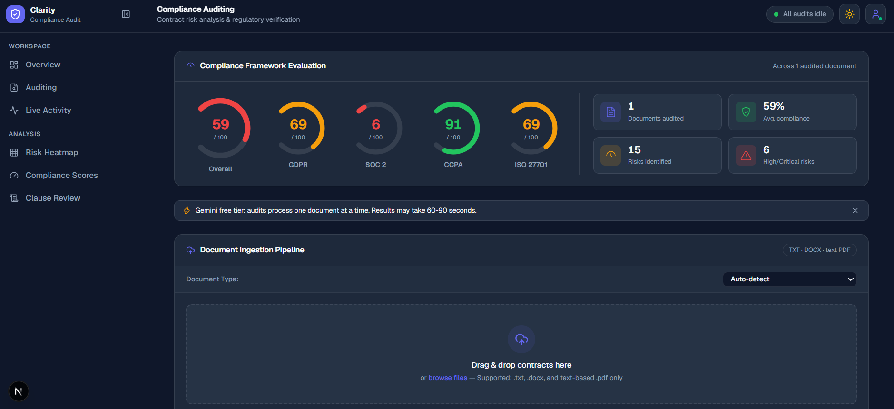
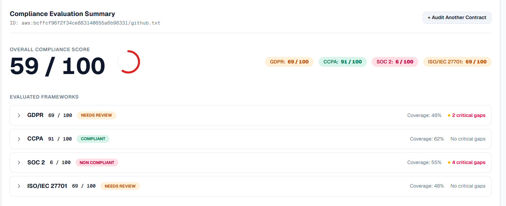
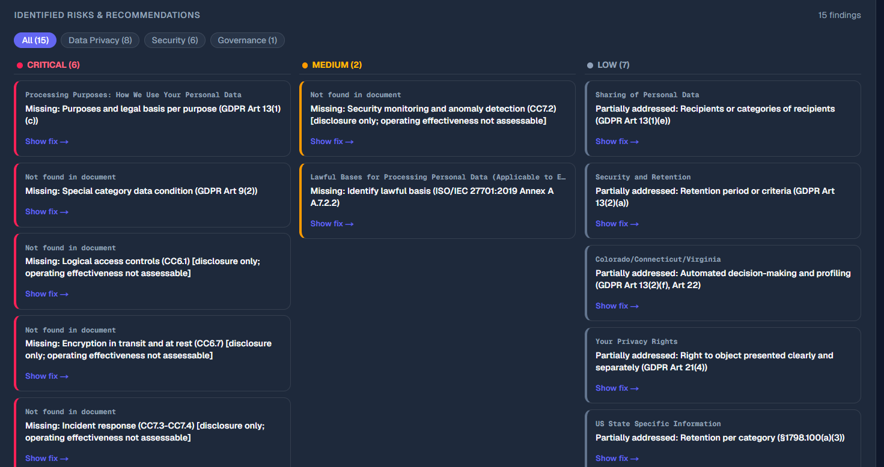
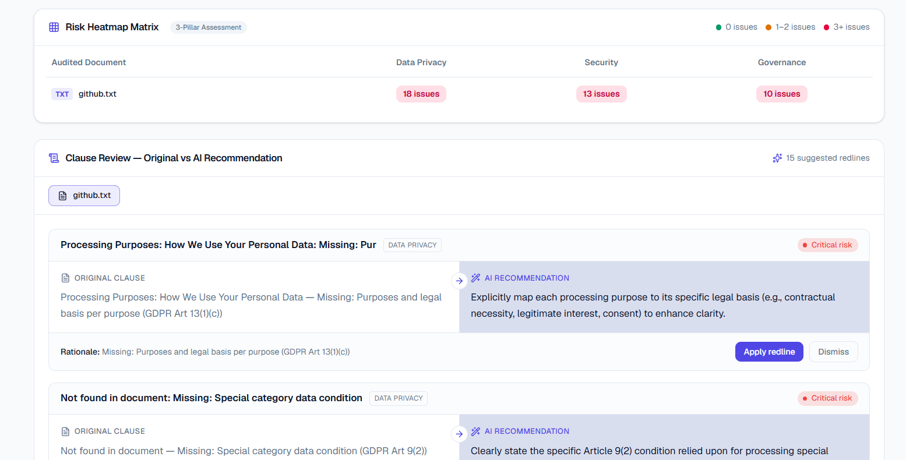
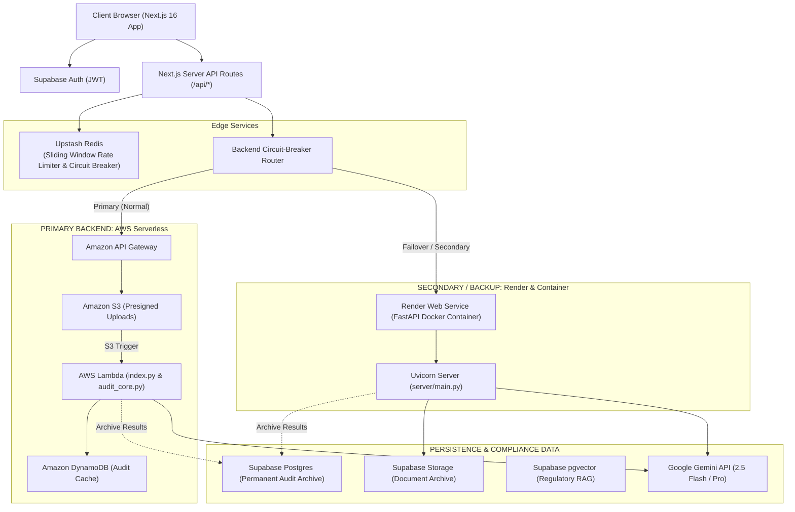

# Enterprise AI Compliance Auditing Platform
### Powered by AWS Serverless (AWS Lambda · Amazon S3 · Amazon DynamoDB · Amazon API Gateway)

[](https://aws.amazon.com/)
[-FF9900?style=flat&logo=awslambda&logoColor=white)](https://aws.amazon.com/lambda/)
[](https://aws.amazon.com/s3/)
[](https://aws.amazon.com/dynamodb/)
[](https://aws.amazon.com/api-gateway/)
[](https://nextjs.org/)
[](https://fastapi.tiangolo.com/)
[](https://supabase.com/)
[](https://upstash.com/)
[](https://aistudio.google.com/)
[](LICENSE)

> ### ⚡ Primary Cloud Engine: AWS Serverless Backbone
> The production platform runs natively on an event-driven **AWS Serverless** architecture designed for enterprise throughput:
> - 🚀 **AWS Lambda (Python 3.12, 512 MB, 300s)**: High-concurrency serverless engine that asynchronously analyzes contracts, runs multi-pass Gemini reasoning, and deterministically verifies statutory quotes against raw text.
> - 🗄️ **Amazon S3**: Encrypted multi-part contract ingestion vault with time-limited presigned URLs (`uploads/<uuid>/<filename>`) and automatic S3 event triggers.
> - ⚡ **Amazon DynamoDB**: Low-latency NoSQL database for real-time audit progress tracking, idempotency locking, and compliance audit logs.
> - 🌐 **Amazon API Gateway**: Token-authenticated RESTful API endpoints (`/upload`, `/audit`, `/results/{id}`) with CORS isolation and rate protection.

An enterprise-grade contract compliance auditing platform that analyzes legal documents (Privacy Notices, DPAs, Security Policies) against four major regulatory frameworks: **GDPR**, **CCPA / CPRA**, **SOC 2**, and **ISO/IEC 27701**.

Built on a **deterministic verification architecture**: Google Gemini extracts and classifies verbatim evidence from clauses, while deterministic Python code verifies text matches, calculates scores, and establishes risk severity. **No score is hallucinated, and no compliance number is fabricated.**

---

## Interactive Table of Contents

- [AWS Serverless Primary Architecture](#primary-cloud-architecture-aws)
- [Visual Previews & Screenshots](#visual-previews--screenshots)
- [System Architecture (Dual-Backend Flow)](#system-architecture)
- [Backup / Secondary Architecture (Render & Supabase)](#backup--secondary-architecture-render--supabase)
- [Key Features](#key-features)
- [Quick Start (Local Development)](#quick-start-local-development)
- [Deployment Guide](#deployment-guide)
  - [1. Deploy Primary on AWS](#3-deploy-primary-on-aws)
  - [2. Deploy Frontend on Vercel](#1-deploy-frontend-on-vercel)
  - [3. Deploy Backend on Render](#2-deploy-backend-on-render)
- [Public Evaluator & Demo Guide](#public-evaluator--demo-guide)
- [Environment Variables](#environment-variables)
- [Security & Rate Limiting](#security--rate-limiting)

---

## Visual Previews & Screenshots

### 1. Compliance Dashboard Overview

*Figure 1: Main compliance overview showing radial gauges, document upload zone, and framework health scores.*

### 2. Multi-Framework Compliance Evaluation Summary

*Figure 3: Multi-framework assessment breakdown across GDPR, CCPA/CPRA, SOC 2, and ISO/IEC 27701.*

### 3. Identified Risks & Actionable Fix Recommendations

*Figure 4: Granular findings with severity tagging (Critical, Medium, Low) and concrete remediation suggestions.*

### 4. 3-Pillar Risk Heatmap Matrix

*Figure 5: Risk matrix classifying findings across Legal, Security, and Operational dimensions.*


---

## System Architecture

The platform operates on a **Dual-Backend High-Availability Design** with an automatic circuit-breaker router:



---

## Primary Cloud Architecture (AWS)

The production backbone is built on AWS serverless services for infinite scalability:

1. **Amazon API Gateway (`POST /upload`, `GET /results/{id}`, `POST /audit`)**: Provides server-to-server endpoints protected with token authorization.
2. **Amazon S3**: Incoming documents are uploaded via short-lived, pre-signed URLs directly from the client to S3 (`uploads/<uuid>/<filename>`).
3. **AWS Lambda (Python 3.12, 512 MB, 300s timeout)**:
   - Pure logic engine in `audit_core.py`.
   - Heuristically classifies document type (`privacy_notice`, `dpa`, `security_policy`).
   - Resolves requirements across 115 versioned compliance rules.
   - Executes multi-pass Gemini analysis with exponential backoff.
   - Verifies quotes verbatim against extracted document text.
4. **Amazon DynamoDB**: Stores transient processing stages and immediate audit findings.
5. **AWS Systems Manager (SSM) Parameter Store**: Stores confidential secrets (`GEMINI_API_KEY`, tokens) under `/compliance/prod/*`.

---

## Backup / Secondary Architecture (Render & Supabase)

To guarantee zero downtime and eliminate single-cloud vendor lock-in, the system includes a fully autonomous **Secondary Backend**:

- **Render Web Service (`server/`)**: A containerized FastAPI application running via Docker (`server/Dockerfile` and root `render.yaml`).
- **Supabase Permanent Database (`supabase/schema.sql`)**: All completed audits from both AWS and Render are permanently archived in Supabase Postgres (`audit_results` table).
- **Supabase Storage (`audit-uploads`)**: Secondary upload bucket that receives files via secure signed URLs when AWS is unreachable.
- **Failover Modes**:
  - `auto`: Pings AWS API Gateway. If unresponsive or returning 5xx/429, seamlessly flips traffic to Render.
  - `secondary`: Routes all traffic directly to Render (ideal for development, staging, or teams without AWS access).
  - `primary`: Strictly routes to AWS.

---

## Key Features

- **4 Core Frameworks Evaluated**:
  - **GDPR**: Data subject rights, legal bases, subprocessor terms, international transfers.
  - **CCPA / CPRA**: Opt-out disclosures, sensitive personal information handling, notice at collection.
  - **SOC 2**: Security controls, public disclosure limitations, audit report commitments.
  - **ISO/IEC 27701:2019**: Privacy information management system (PIMS) obligations.
- **Deterministic Math & Quotation Verification**:
  - LLM outputs verbatim quote string + status.
  - Python engine fuzzy-matches quote in original source document.
  - Unverified quotes are penalized; fabricated citations are flagged.
- **3-Pillar Risk Matrix**:
  - Automatically maps risks to **Legal**, **Security**, and **Operational** impact pillars.
- **Sliding-Window Rate Limiting**:
  - Powered by Upstash Redis (5 audit scans per user/IP per hour) to safeguard LLM quotas.
- **Enterprise UI**:
  - Dark / Light mode with persistent storage.
  - Interactive radial compliance gauges.
  - Seamless user profile popover and Supabase Auth integration.

---

## Quick Start (Local Development)

### Prerequisites
- Node.js 18+ & npm
- Python 3.11+
- Free Supabase project ([supabase.com](https://supabase.com))
- Free Upstash Redis database ([upstash.com](https://upstash.com))
- Google Gemini API Key ([aistudio.google.com](https://aistudio.google.com))

### 1. Clone & Install Dependencies
```bash
git clone https://github.com/your-username/ai-compliance-dashboard.git
cd ai-compliance-dashboard

# Install frontend dependencies
npm install

# Setup Python backend virtual environment
python -m venv .venv
# Windows:
.\.venv\Scripts\activate
# Linux/macOS:
source .venv/bin/activate

pip install -r server/requirements.txt pytest
```

### 2. Configure Environment
Copy `.env.example` to `.env.local` and add your keys:
```bash
cp .env.example .env.local
```

### 3. Initialize Supabase Database
In your Supabase project's **SQL Editor**, run the contents of [`supabase/schema.sql`](./supabase/schema.sql). This creates:
- `audit_results` (archival table with RLS)
- `compliance_requirements` (pgvector regulatory table)
- `match_regulatory_rules` (RPC search function)

### 4. Start Local Development Servers
**Terminal 1 — Python Backend:**
```bash
.\.venv\Scripts\python.exe -m uvicorn server.main:app --port 8000 --reload
```

**Terminal 2 — Next.js Frontend:**
```bash
npm run dev
```

Visit [http://localhost:3000](http://localhost:3000) in your browser.

---

## Deployment Guide

### 1. Deploy Frontend on Vercel
1. Import this repository into [Vercel](https://vercel.com).
2. Framework preset: **Next.js**.
3. Under **Project Settings > Environment Variables**, add:
   - `NEXT_PUBLIC_APP_URL` = `https://your-app.vercel.app`
   - `NEXT_PUBLIC_SUPABASE_URL` = `https://xxxx.supabase.co`
   - `NEXT_PUBLIC_SUPABASE_ANON_KEY` = `sb_publishable_...`
   - `SUPABASE_URL` = `https://xxxx.supabase.co`
   - `SUPABASE_SECRET_KEY` = `sb_secret_...`
   - `UPSTASH_REDIS_REST_URL` = `https://xxxx.upstash.io`
   - `UPSTASH_REDIS_REST_TOKEN` = `AX...`
   - `BACKEND_SHARED_TOKEN` = `your-secure-32-char-token`
   - `SECONDARY_BACKEND_URL` = `https://your-backend.onrender.com`
   - `PRIMARY_BACKEND_URL` = `https://your-api.execute-api.us-east-1.amazonaws.com/prod` (optional)
   - `FAILOVER_MODE` = `auto` (or `secondary`)
4. Click **Deploy**.

---

### 2. Deploy Backend on Render
This repository includes a pre-configured [`render.yaml`](./render.yaml) Blueprint:
1. Log in to [Render](https://render.com) and click **New > Blueprint**.
2. Select your repository. Render automatically reads `render.yaml` and configures the Docker web service.
3. Supply the environment variables in the Render dashboard:
   - `GEMINI_API_KEY` = `AIzaSy...`
   - `SUPABASE_URL` = `https://xxxx.supabase.co`
   - `SUPABASE_SECRET_KEY` = `sb_secret_...`
   - `BACKEND_SHARED_TOKEN` = `your-secure-32-char-token`
   - `ALLOWED_ORIGIN` = `https://your-app.vercel.app`
4. Deploy the service. Your backend will be accessible at `https://compliance-audit-server.onrender.com`.

---

### 3. Deploy Primary on AWS
1. Package the Lambda function:
   ```powershell
   .\scripts\package_lambda.ps1
   ```
2. Apply Terraform infrastructure:
   ```bash
   cd terraform
   terraform init
   terraform apply
   ```
3. Copy the output API Gateway invoke URL into `PRIMARY_BACKEND_URL`.

---

## Public Evaluator & Demo Guide

If you are an evaluator, recruiter, or developer testing this platform **without active AWS credentials**, you can run the entire system using the **Secondary Backup Architecture**:

1. Set `FAILOVER_MODE=secondary` in your `.env.local` or Vercel settings.
2. The platform will automatically route document parsing, evidence verification, and audit classification through the FastAPI / Render service and Supabase Postgres archive.
3. Test documents are available in the [`calibration/`](./calibration/) directory:
   - [`calibration/set_01_privacy_notice/`](./calibration/set_01_privacy_notice/) — Sample Privacy Notices
   - [`calibration/set_02_dpa/`](./calibration/set_02_dpa/) — Data Processing Agreements
   - [`calibration/set_03_security_policy/`](./calibration/set_03_security_policy/) — Information Security Policies

---

## Environment Variables

| Variable | Scope | Required | Purpose |
|---|---|---|---|
| `NEXT_PUBLIC_SUPABASE_URL` | Public (Client & Server) | Yes | Supabase endpoint URL for Auth and DB |
| `NEXT_PUBLIC_SUPABASE_ANON_KEY` | Public (Client & Server) | Yes | Supabase anonymous public key |
| `SUPABASE_URL` | Server Only | Yes | Server-side Supabase REST endpoint |
| `SUPABASE_SECRET_KEY` | Server Only | Yes | Service-role key for database archival & storage |
| `GEMINI_API_KEY` | Server Only | Yes | Google Gemini LLM API key |
| `UPSTASH_REDIS_REST_URL` | Server Only | Yes | Upstash Redis endpoint for sliding-window rate limits |
| `UPSTASH_REDIS_REST_TOKEN` | Server Only | Yes | Upstash Redis authentication token |
| `BACKEND_SHARED_TOKEN` | Server Only | Yes | Cryptographic shared secret between Next.js and Python |
| `FAILOVER_MODE` | Server Only | Yes | `auto`, `primary` (AWS), or `secondary` (Render) |
| `PRIMARY_BACKEND_URL` | Server Only | Optional | AWS API Gateway URL |
| `SECONDARY_BACKEND_URL` | Server Only | Yes | Render / local FastAPI service URL |

---

## Security & Rate Limiting

- **Zero Client-Exposed Secrets**: Gemini API keys, Supabase Service Role keys, and backend communication tokens are strictly isolated in server-side memory.
- **Sliding-Window Rate Limiting**: Upstash Redis limits users to **5 audits per hour** to prevent API exhaustion and abuse.
- **RLS Enabled**: Supabase Row-Level Security ensures authenticated users can only view their own archived audits.
- **Verifiable Auditing**: Any auditor can expand compliance requirements in the UI to inspect the exact verbatim excerpt verified by the engine.

---

## License

This project is licensed under the MIT License. See [LICENSE](LICENSE) for details.
